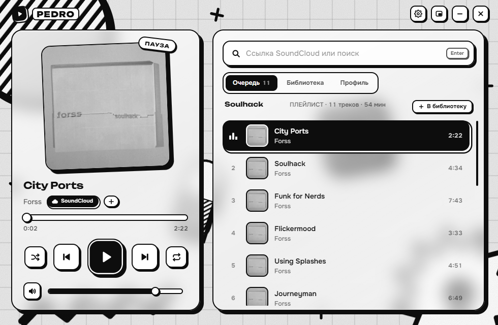
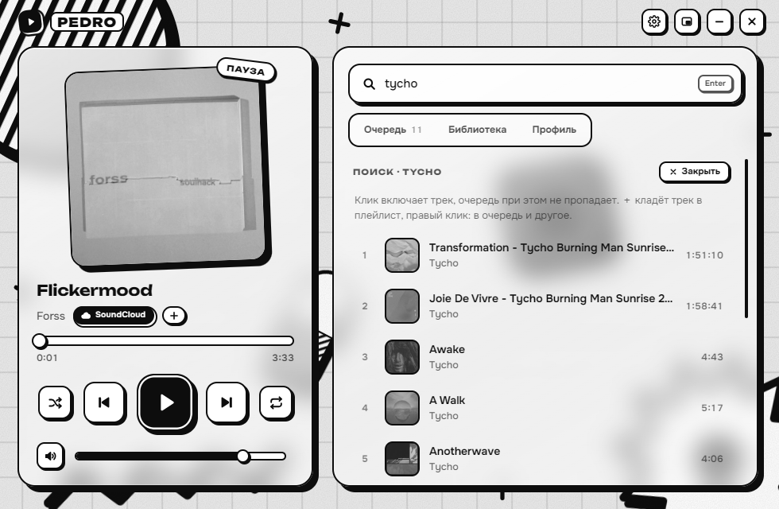
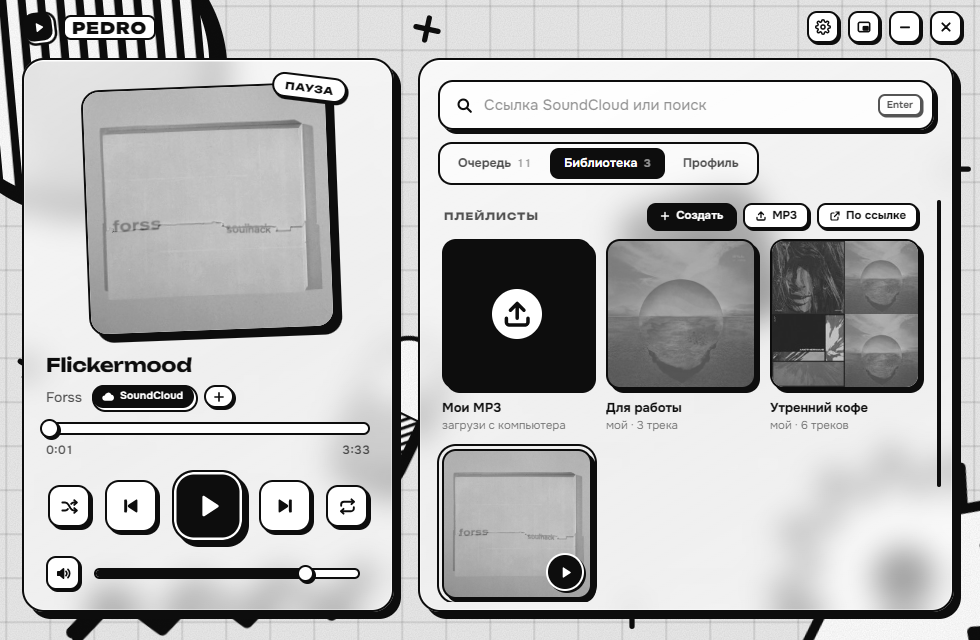
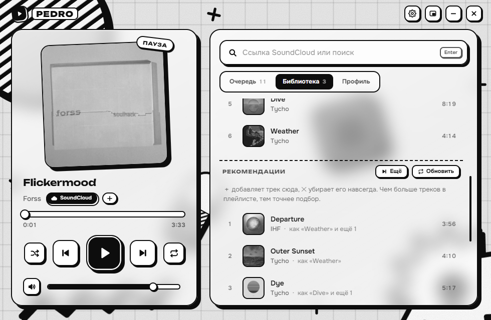
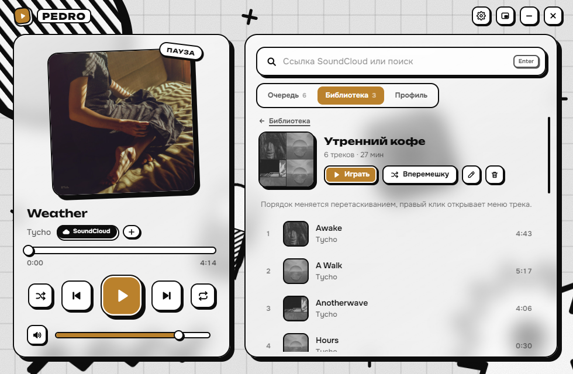
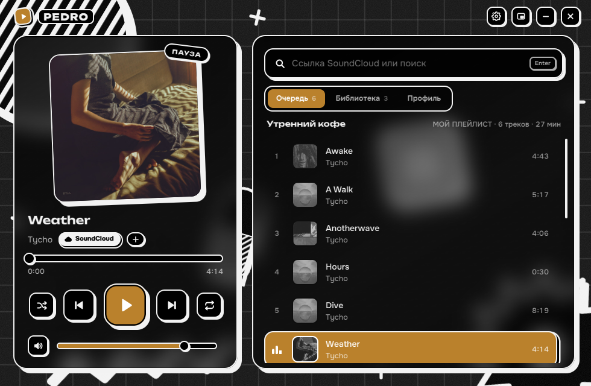
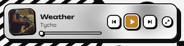

# Pedro

Лёгкий музыкальный плеер для Windows, который играет музыку из SoundCloud.
Стиль: чёрно-белый glassmorphism (матовые стеклянные панели) + neobrutalism
(жирная чёрная обводка, жёсткие тени, «штампованные» кнопки).



| Поиск прямо в плеере | Библиотека |
|---|---|
|  |  |
| **Рекомендации в плейлисте** | **Цвет от обложки** |
|  |  |
| **Тёмная тема** | **Мини-плеер** |
|  |  |

**Фон:** бумага с жирной сеткой и крупные фигуры в духе необрутализма: круг со штриховкой,
звезда-«взрыв», повёрнутый квадрат, зигзаг, плюсы. Всё с толстой обводкой и жёсткими
тенями, под стеклом панелей фигуры мягко размываются. Фигуры медленно двигаются (выключается в ⚙).

**Обложка прыгает** (⚙: Выкл / Мягко / Сильно): обложка чуть подпрыгивает на высоких ударах:
хэтах, снейрах, хлопках. Их Pedro находит сам в **собственном** звуке (Windows process loopback
к звуковому процессу своего WebView2: другие программы и микрофон не слышны, ничего не
записывается). Когда Pedro свёрнут, захват звука останавливается, музыка играет дальше.
Обложки показаны в ч/б, при наведении становятся цветными.

## Скачать

1. Открой страницу [последнего релиза](../../releases/latest) и скачай `Pedro-win-x64.zip`.
2. Распакуй архив в любую папку и запусти `Pedro.exe`.

Windows может показать «Windows защитила ваш компьютер»: программа не подписана сертификатом.
Нажми «Подробнее» → «Выполнить в любом случае». Нужна Windows 10 или 11 (64-бит).

## Запуск

Открой `dist\Pedro.exe`. Устанавливать ничего не нужно: используется
Microsoft Edge WebView2, который уже есть в Windows 10/11.

Папка `dist` весит ~1,4 МБ, её можно перенести куда угодно целиком.

## Как пользоваться

- **Вставь ссылку SoundCloud** в строку справа (или просто нажми `Ctrl+V` в окне):
  трек, плейлист/альбом, профиль артиста или `soundcloud.com/имя/likes`. Если ничего не играет,
  ссылка сразу играет. Иначе появляется карточка: трек можно **включить сейчас** (очередь
  остаётся и продолжится после него), **поставить в очередь** или **добавить в плейлист**;
  плейлист, артиста или лайки — включить или сохранить в библиотеку. Ссылка, скопированная
  в браузере, тоже появляется такой карточкой.
- **Поиск прямо в Pedro:** набери название и нажми Enter. Результаты SoundCloud с обложками
  и длительностью; клик включает трек (очередь не пропадает), ＋ кладёт в плейлист, правый
  клик: «Играть следующим», «В конец очереди». «Ещё результаты» внизу, Esc закрывает поиск.
- **Наушники и медиаклавиши:** Pedro зарегистрирован в медиаэлементах Windows, поэтому
  работают кнопки наушников (AirPods: 1 нажатие — пауза/игра, 2 — следующий, 3 — предыдущий)
  и медиаклавиши клавиатуры. Трек с обложкой виден в плашке громкости и на экране блокировки.
  Если играет несколько плееров, Windows отдаёт кнопки последнему активному.
- **Трей:** ✕ и — прячут Pedro к часам, музыка играет и переключается дальше. Клик по
  значку открывает плеер, правый клик: трек, «Играть/пауза», «Следующий», «Предыдущий»,
  «Выход». В ⚙ «Сворачивать в трей» можно выключить.
- **Живой фон:** фигуры на фоне медленно крутятся и плавают, сетка ползёт. Выключается в ⚙
  «Анимация фона»; пока окно свёрнуто или в трее, фон стоит и не тратит ресурсы.
- **Удаление и порядок запоминаются.** ✕ при наведении на трек (или правый клик →
  «Удалить из …») удаляет его из плейлиста, лайков или артиста, и после перезапуска он не
  вернётся. Перетащенный порядок тоже сохраняется. Это правки внутри Pedro: на самом
  SoundCloud плейлист не меняется. **Ctrl+Z** возвращает последний удалённый трек, строка
  «N треков ты убрал… Вернуть» в конце списка возвращает все на их места (музыка не прерывается).
  В своих плейлистах удаление из очереди удаляет трек из самого плейлиста.
- **Свои MP3:** перетащи аудиофайлы в окно (или кнопка «MP3» в библиотеке, или `Ctrl+O`).
  Подходят mp3, m4a, flac, wav, ogg. Название, артист и обложка берутся из тегов файла, без тегов
  из имени вида «Артист - Название.mp3». Файлы копируются внутрь Pedro, так что оригинал можно
  удалить. Всё лежит в плитке «Мои MP3»; их можно добавлять в свои плейлисты, перемотка, медиаклавиши
  и статистика работают как с треками SoundCloud. ✕ на странице «Мои MP3» удаляет файл.
- **Библиотека:** сетка плейлистов, всё открывается прямо в ней, без перехода в очередь.
  ▶ на плитке включает или ставит на паузу, не открывая плейлист. Клик по плейлисту SoundCloud
  открывает его страницу с треками и включает его; клик по своему плейлисту открывает его
  страницу. «＋ Создать»: свой плейлист (хранится на компьютере), треки в него добавляются
  кнопкой ＋ у обложки, в очереди, в поиске, в рекомендациях или из карточки ссылки; если этот
  плейлист сейчас играет, новый трек сразу попадает и в очередь.
  Сохранённые плейлисты SoundCloud тоже есть в меню «Добавить в плейлист»: SoundCloud не даёт
  менять плейлисты без входа, поэтому трек добавляется в него внутри Pedro (как удаление и порядок)
  и играет в нём здесь, а на самом SoundCloud плейлист не меняется. «По ссылке»: сохранить
  плейлист, альбом, артиста или лайки с SoundCloud. Ниже «Недавнее».
- **Моя волна** вверху библиотеки — подборки по твоей статистике: «Любимое за месяц» (больше всего
  слушал за 30 дней), «Давно не слушал» (слушал часто, но не включал больше месяца; появится, когда
  накопится статистика) и «Новое для тебя» (похожее на любимое за месяц, чего ты ещё не слышал;
  собирается раз в день, ⟳ на её странице собирает заново).
- **Перетаскивание в плейлист:** потяни трек из очереди, поиска, рекомендаций или подборки, и внизу
  появится полоса с плейлистами: брось трек на нужный (или на «Новый»). Плитки плейлистов в
  библиотеке тоже принимают треки.
- **Цвет от обложки** (⚙): кнопка «играть», прогресс, играющий трек и вкладки красятся в главный
  цвет обложки, сама обложка становится цветной. У чёрно-белых обложек всё остаётся ч/б.
- **Все треки списка видны сразу.** Виджет SoundCloud описывает длинный список только вокруг
  играющего трека, поэтому названия, артистов и обложки остальных Pedro подтягивает сам
  (oEmbed, а для треков, которые его не отдают, — второй скрытый виджет) и запоминает.
- **Рекомендации** под треками своего плейлиста и в конце очереди (любой плейлист SoundCloud,
  лайки, артист): похожая музыка с SoundCloud. В плейлисте ＋ кладёт трек в него, в очереди ставит в конец
  очереди; клик просто включает рекомендации, а очередь ждёт и возвращается по «К очереди» или сама, когда они закончатся; ✕ убирает навсегда, «Ещё» листает, «Обновить» подбирает заново. Подбор свой:
  берёт «похожие» и чужие плейлисты для каждого твоего трека, оставляет то, на что указывают
  несколько треков сразу и что «смотрит» обратно на твой плейлист, сверяет жанр, теги и длину,
  убирает 30-секундные превью и повторы одной песни (speed up / slowed / перезаливы), учитывает
  твою статистику и крестики. Пустой плейлист подбирает по тому, что ты слушаешь чаще всего.
- **Профиль:** укажи свой профиль SoundCloud (ссылку или ник), и «Мои лайки» с «Моими
  треками» будут под рукой. Там же статистика за неделю, месяц, год и всё время: время
  прослушивания, сколько треков и прослушиваний, любимый трек и топ треков.
  SoundCloud не отдаёт историю прослушиваний, поэтому Pedro считает её сам, на этом
  компьютере (прослушивание засчитывается после 30 секунд или половины трека).
- **Мини-плеер** (кнопка в заголовке) — маленькое окно поверх всех окон в углу экрана.
- Последний плейлист и трек в нём восстанавливаются при запуске.

### Горячие клавиши

| Клавиша | Действие |
|---|---|
| `Пробел` | играть / пауза |
| `←` / `→` | перемотка на 10 с |
| `Ctrl+←` / `Ctrl+→` | предыдущий / следующий трек |
| `↑` / `↓` | громкость |
| `M` / `S` / `R` | без звука / перемешать / повтор |
| `Ctrl+Z` | вернуть последний удалённый трек |
| `Ctrl+O` | загрузить свои mp3 |
| `/` или `Ctrl+F` | к строке поиска |
| `Esc` | закрыть поиск / карточку ссылки |
| Медиаклавиши, кнопки наушников | через медиаэлементы Windows |

## Сборка

```powershell
.\build.ps1
```

Скрипт один раз скачивает WebView2 SDK с nuget.org в `lib\`, затем компилирует
`host\Pedro.cs` компилятором C#, встроенным в .NET Framework 4.8 (Visual Studio не нужна).
Иконку можно перерисовать скриптом `tools\make-icon.ps1`.

## Устройство

```
app\        интерфейс: index.html, style.css, app.js, шрифты Unbounded + Onest
host\       нативное окно: Pedro.cs (WinForms + WebView2), манифест, иконка
dist\       готовая программа
```

- Окно без рамки, но с системной тенью, скруглёнными углами Windows 11 и анимацией сворачивания.
- Звук идёт через скрытый официальный виджет SoundCloud. Интерфейс только управляет им,
  ключи SoundCloud API не нужны.
- Сетевые запросы страницы (oEmbed, поиск, страницы треков для рекомендаций) проходят через
  нативную часть и разрешены только к `*.soundcloud.com` по HTTPS. Внешние ссылки открываются только на SoundCloud.
- Буфер обмена читается только при активации окна, и только ссылки на soundcloud.com.
- Во время игры: несколько процентов одного ядра CPU. Памяти около 370 МБ, почти всё это
  движок Edge (WebView2).

Данные (настройки, библиотека, статистика, позиция окна) лежат в `%LOCALAPPDATA%\Pedro`.

## Лицензия

Код Pedro: MIT (см. [LICENSE](LICENSE)). Шрифты Unbounded и Onest распространяются по
SIL Open Font License 1.1. Pedro не связан с SoundCloud: музыка играет через официальный
виджет SoundCloud, права на треки принадлежат их авторам.
